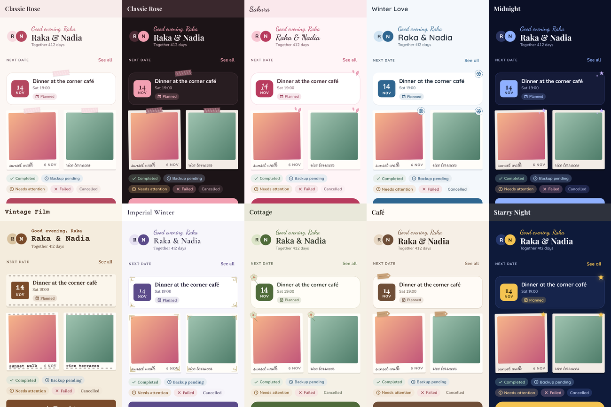
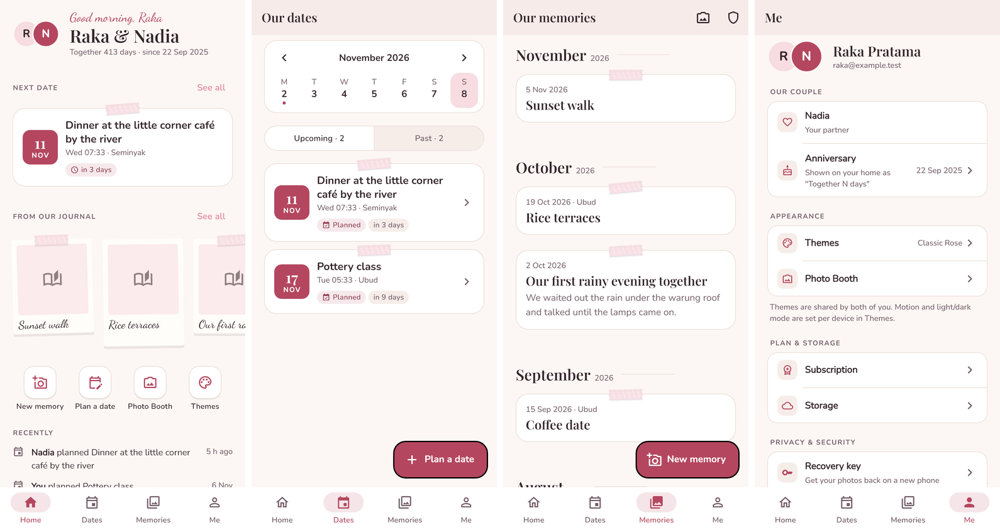
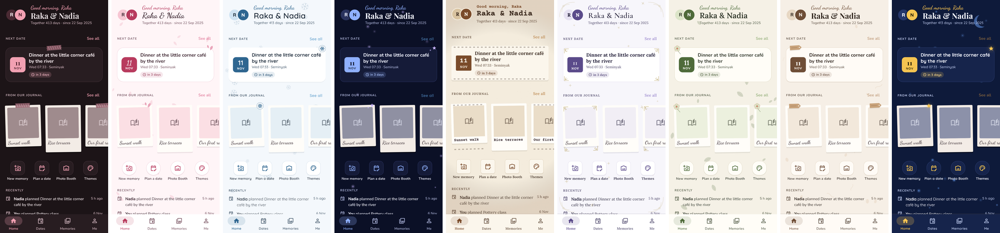
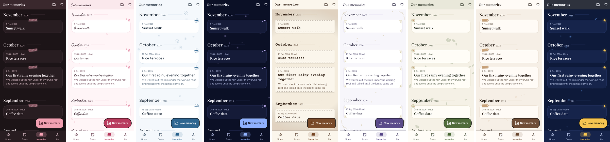

# Design System — Flutter

Status: implemented (Steps 3–7). Tokens, core components, all main screens and the admin panel use this system. Direction: [design-direction.md](design-direction.md). Audit: [ui-ux-audit.md](ui-ux-audit.md).



## Rules

1. Screens read **only** `context.tokens`, `context.motion`, `AppSpacing`, `AppRadius`. No `Color(0x…)`, no hard-coded font sizes, no `Colors.*` except `Colors.transparent` and the photo viewer's black.
2. Import components from one file: `import 'package:frontend/core/widgets/app_widgets.dart';`
3. Status is shown by colour **and** icon **and** words (`StatusChip`).
4. Ornaments decorate only memory/date cards and photo frames (`JournalCard(ornament: true)`, `PolaroidFrame`). Never over text or controls.
5. Every animation takes its duration from `context.motion` (zero under reduce motion).

## Layers

| Layer | Where | What |
|---|---|---|
| Theme data | `lib/core/theme/theme_definition.dart`, `themes/*.dart`, `theme_registry.dart` | Palette, typography, component shapes, background decoration, **ornament** per theme |
| Couple customization | `theme_customization.dart` (unchanged wire format, `PUT /couple/theme`) | Accent/background/font presets, decorations and animation toggles, layout styles |
| User preferences | `appearance_controller.dart` (device only) | Theme mode, **reduce motion** (now also sets `tokens.reduceMotion`) |
| Resolved tokens | `app_theme_tokens.dart` (`ThemeExtension`, lerps) | Everything below; read via `context.tokens` |
| Material mapping | `app_theme.dart` | `ThemeData` for buttons, inputs, nav bar, sheets, dialogs, snack bars, chips, switches, list tiles |
| Core components | `lib/core/widgets/**` | Theme-aware building blocks |

Theme switching still goes through `MaterialApp` → `AnimatedTheme`; tokens interpolate, so no route rebuild or app reload.

## Tokens (`context.tokens`)

**Colour**: `primary`, `onPrimary`, `primaryDark`, `secondary`, `accent` (decorative only), `background`, `surface`, `surfaceMuted`, `paper` + `onPaper` (polaroid prints), `textPrimary`, `textSecondary`, `border`, `success`, `warning`, `error`, `info`.
Status helpers: `toneContainer(StatusTone)`, `onToneContainer(StatusTone)`, `tone(StatusTone)` for `neutral · brand · success · warning · error · info`. Tested ≥ 4.5:1 on every theme and mode.

Themes may omit `success/warning/error/info/surfaceMuted/paper`; `AppTheme.resolveTokens` derives accessible values for the palette's brightness.

**Type**: `display` (32) · `title` (22) · `heading` (17/700) · `subtitle` (16) · `body` (15) · `label` (13/600) · `caption` (12.5) · `overline` (11/700, +1.2) · `handwriting` (20, captions only) · `button` (15/700). Families come from the theme or the couple's font preset; all bundled.

**Shape**: `cardRadius`, `buttonRadius`, `chipRadius`, `sheetRadius`, `photoRadius`, `cardBorder`, `cardElevation`. **Elevation**: `tokens.elevation(0..3)` returns ink-tinted shadows (borders carry depth in dark mode).

**Identity**: `navigation` (flat / tinted / elevated, applied to app bar and nav bar), `ornament`, `ornamentsEnabled` (couple's decorations toggle), `decoration` + `decorationsEnabled` (background), `animation` + `animationsEnabled`, `reduceMotion`, `coupleSpaceStyle`, `memoryStyle`.

**Spacing** (`AppSpacing`): `xxs 2 · xs 4 · sm 8 · smd 12 · md 16 · lg 24 · xl 32 · xxl 48`, `gutter 20`, `maxContentWidth 640`, `minTouch 48`.
**Radius** (`AppRadius`): `xs 6 · sm 10 · md 14 · lg 20 · xl 28 · pill`.
**Motion** (`context.motion`): `fast 120ms · base 220ms · slow 360ms`, `stagger(i)`, `pressScale`, `reduced`. Curves `AppMotion.standard`, `AppMotion.emphasized`.

## Ornaments per theme

| Theme | `OrnamentKind` |
|---|---|
| Classic Rose | `washiTape` |
| Sakura | `petal` |
| Winter Love | `snowflakeStamp` |
| Midnight | `star` |
| Vintage Film | `filmSprockets` (+ Courier Prime captions, square photo corners) |
| Imperial Winter | `filigree` |
| Cottage | `pressedFlower` |
| Café | `kraftTag` |
| Starry Night | `goldStar` |

New theme = one `ThemeDefinition` (pick an ornament) + one catalog entry; no component code changes.

## Components

| Component | File | Use for |
|---|---|---|
| `AppScaffold` | `app_scaffold.dart` | Page shell: max width, gutter, optional theme background |
| `AppButton` | `app_button.dart` | `primary · secondary · ghost · destructive`, icon, loading (announced, can't double-submit) |
| `AppTextField` | `app_text_field.dart` | Inputs; borders from theme, `helper` text |
| `SectionHeader` | `section_header.dart` | Overline or large title + "See all" |
| `JournalCard` | `journal/journal_card.dart` | Every card; press scale, optional ornament, semantic label |
| `PolaroidFrame` | `journal/polaroid_frame.dart` | Photo prints with handwritten caption; deterministic tilt; takes any photo widget (no image loading, no URLs) |
| `DateBadge` | `journal/date_badge.dart` | Ticket stub "14 / NOV" (`strong · soft · muted`) |
| `CoupleAvatars` | `journal/couple_avatars.dart` | Two initials, or a "waiting" ring before the partner joins |
| `Ornamented` | `journal/ornament.dart` | Theme ornament on any widget edge |
| `StatusChip` | `status_chip.dart` | Colour + icon + label status |
| `AppStateView` | `app_state_view.dart` | `.loading · .empty · .error · .offline`; overflow-safe, `scrollable` for pull-to-refresh |
| `SkeletonBox` | `app_state_view.dart` | Loading placeholders (static under reduce motion) |
| `SpotIllustration` | `spot_illustration.dart` | Line illustrations: camera, calendar, envelope, cloudOff, heart, palette, lock |
| `SettingsGroup` / `SettingsTile` | `settings_group.dart` | Profile & settings lists (56dp rows, destructive variant) |
| `showConfirmSheet` | `confirm_sheet.dart` | Confirmations; `true` only on confirm |
| `AppFormatters` | `lib/core/format/app_formatters.dart` | Dates, times, "in 3 days", "2 h ago" |
| `NoticeBanner` | `notice_banner.dart` | Inline message in a tone (form errors, plan notes, offline) |
| `CommentBubble` | `comment_bubble.dart` | Notes on dates and memories (yours right/tinted, partner's left) |
| `BrandMark` | `brand_mark.dart` | "our little space ♥" wordmark (always the brand serif) |
| `MemoryCover` | `features/memories/presentation/widgets/memory_cover.dart` | Decrypted cover photo or a paper placeholder |
| `DateTicketCard`, `DateStatusChip` | `features/home/presentation/…` | Date cards and `planned/completed/cancelled` chips |

## Accessibility guarantees (tested)

- Text, secondary text and button text ≥ 4.5:1 on every theme × mode × accent/background preset (`test/core/theme/built_in_themes_test.dart`), now including Classic Rose.
- Status chips, polaroid captions, captions on muted surfaces ≥ 4.5:1; handwriting and primary links ≥ 3:1 (large text) (`test/core/widgets/design_system_test.dart`).
- Component gallery lays out without overflow in all 9 themes × light/dark at 360×800, 320×640 with 1.3× text, and 900×700.
- Ornaments are `IgnorePointer` + `ExcludeSemantics`; reduce motion zeroes all `context.motion` durations.

## Visual snapshots

```bash
flutter test test/visual --dart-define=VISUAL_SNAPSHOTS=true
```

Writes `build/visual/design_system/<theme>_<mode>.png` (set `FLUTTER_ROOT` so Material icons render). Skipped in the normal suite.

## App structure (Step 4)

- **Navigation:** `lib/routing/app_shell.dart` — `StatefulShellRoute` with 4 tabs (Home · Dates · Memories · Me). Each tab keeps its own stack; tapping the active tab returns to its root. The bar is hidden until the couple space exists. Forms, Photo Booth and the photo viewer open on the root navigator (full screen).
- **Home / Couple Space:** couple header (anniversary from `relationship_started_at`, otherwise "Our space since…"; never an invented number), next date, journal strip of polaroids, quick actions, recent activity built from already-loaded dates and memories.
- **Me:** Our couple (partner, anniversary), Appearance, Plan & storage, Privacy & security, Support, Log out (confirm sheet). There is no notification centre in the product; none is shown.
- **Copy:** English everywhere; the previous Indonesian strings in memory detail and comments were translated.

## Admin (Filament) brand layer (Step 5)

| Item | Where |
|---|---|
| Colours, font, logo, favicon, sidebar groups | `backend/app/Providers/Filament/AdminPanelProvider.php` |
| Self-hosted fonts + wordmark CSS | `backend/public/brand/` (Nunito, Playfair Display, OFL licences) — no font CDN |
| Status → colour, one map | `backend/app/Filament/Support/StatusColors.php` |
| Dashboard | `PlatformOverview` (users, couples, active subscriptions only with `billing.view`), `StorageHealthOverview`, `RecentOperatorActivity` |
| Privacy rules | Invite codes masked; couple pages show counts, never memory content; photos are never viewable |

Sidebar: Overview · People · Billing · Content & appearance · Storage & backups.

## Verification

- `test/features/redesign/screens_across_themes_test.dart` — Home, Dates, Memories and Me in all 9 themes × light/dark at 390×844 and 360×740 with 1.3× text; every Couple Space and Memory style.
- `test/visual/screens_snapshot_test.dart` — PNGs of the main screens per theme (`--dart-define=VISUAL_SNAPSHOTS=true`).
- `backend/tests/Feature/Admin/AdminRedesignTest.php` — brand assets, no external fonts, real dashboard counts, billing permission, masked invite codes.




